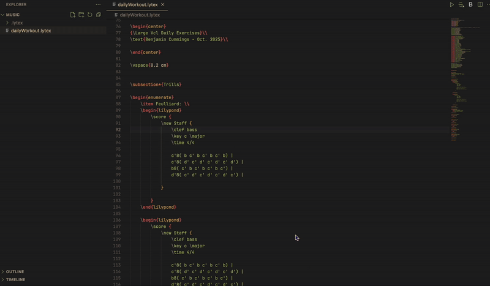

# Lytex Preview: LaTeX + LilyPond Rendering

Render **LaTeX documents with embedded LilyPond** snippets directly to **PDF**, all from within VS Code.  

## Prerequisites
LyTeX Compilation depends requires the following tools to be installed:
- [lilypond](https://lilypond.org/download.html) - includes `lilypond-book` which can embed lilypond in LaTeX.
- [latexit](https://www.chachatelier.fr/latexit/latexit-downloads.php) - For rendering latex.

```bash
  brew install lilypond
  brew install --cask latexit
```

## How to use
- **Render LaTeX with LilyPond** - Embed LilyPond in a LaTeX and save the file with a `.lytex` extension.
  ```latex
  \documentclass{article}
  \usepackage{lilypond}
  
  \begin{document}
    Here’s a simple melody:
    
    \begin{lilypond}
      \relative c' { c d e f g a b c }
    \end{lilypond}
    
  \end{document}
  ```

  See [lilypond-book documentation](https://lilypond.org/doc/v2.23/Documentation/usage/latex) for more information.
  
- **Compile Straight To PDF** — Compile `.lytex` files containing `lilypond` environments directly to PDF.

  
  
- **Lytex Preview Session** — Recompile automatically on save.

  
